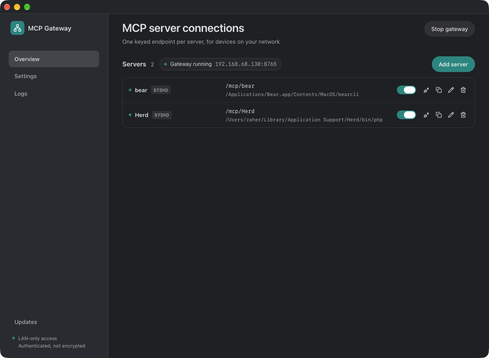
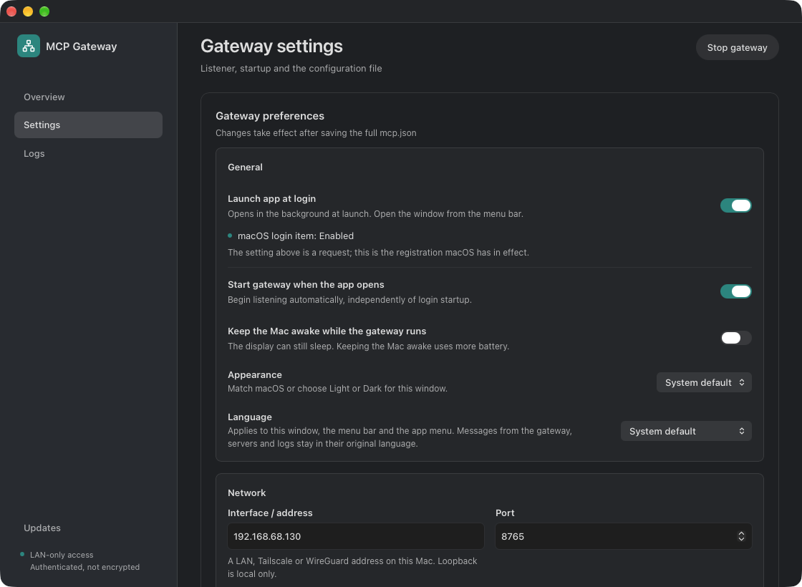
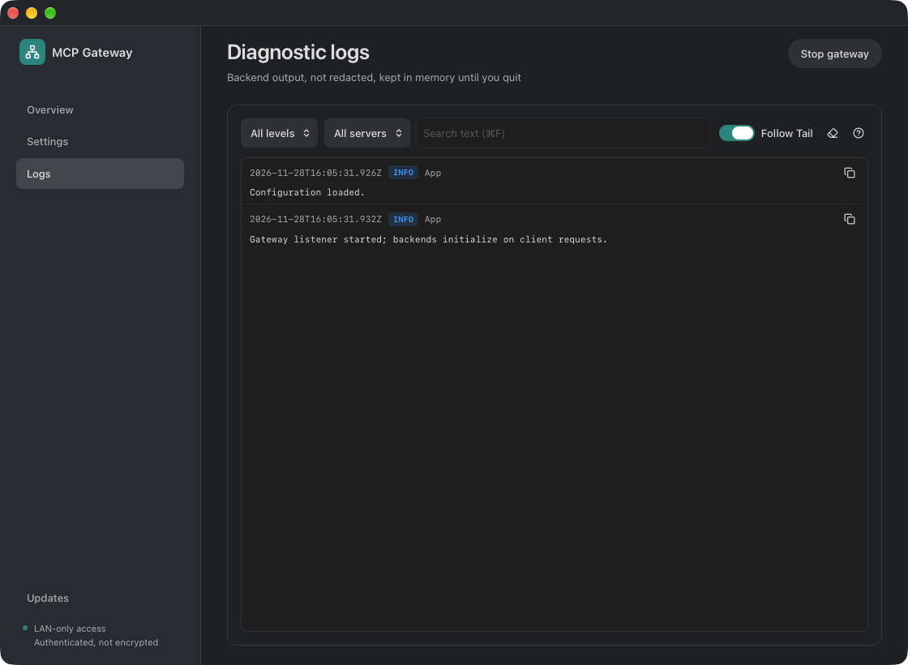

# MCP Gateway

MCP Gateway is a macOS menu-bar app.
It shares local stdio MCP servers and remote Streamable HTTP MCP servers with other devices on a trusted LAN.

> [!NOTE]
> There will be no more changes for the next few weeks/months as I have everything I need from the project. So unless there is something broken I don't think anything will change any soon.

<picture>
  <source media="(prefers-color-scheme: dark)" srcset="docs/images/overview-dark.png">
  <source media="(prefers-color-scheme: light)" srcset="docs/images/overview-light.png">
  
</picture>

## Platform support

The app runs on Apple silicon Macs (arm64) with macOS 14.0 or newer.
It has not been tested on macOS 14.0 itself.
Linux and Windows are not supported.

## Install

Download the signed, notarized DMG from [GitHub Releases](https://github.com/zaherg/mcp-gateway/releases).
Copy the app to a writable location, then open it.

## Quick start

1. Add a server: a local executable or an HTTP(S) MCP server, or import existing servers from Claude Desktop or Cursor in **Settings → Advanced**.
2. In **Settings → Network**, choose a private IPv4 address and a port.
   On a fresh install, the signed app has already generated the global bearer token and stored it in the macOS Keychain.
3. Optionally, give a server its own key in the server dialog.
4. Start the gateway, then copy its configuration into your MCP client.

If an existing configuration contains plaintext keys, **Settings → Security → Move keys to Keychain** moves them without changing the keys your clients use.

Each server gets its own endpoint, such as `http://192.168.1.120:8765/mcp/bear`.
[Getting started](docs/getting-started.md) walks through the same steps with the fields to fill in.

## Screenshots

| Settings | Diagnostic logs |
| --- | --- |
| <picture><source media="(prefers-color-scheme: dark)" srcset="docs/images/settings-dark.png"><source media="(prefers-color-scheme: light)" srcset="docs/images/settings-light.png"></picture> | <picture><source media="(prefers-color-scheme: dark)" srcset="docs/images/logs-dark.png"><source media="(prefers-color-scheme: light)" srcset="docs/images/logs-light.png"></picture> |

## Documentation

- [Getting started](docs/getting-started.md): install the app and serve your first server.
- [Using the app](docs/using-the-app.md): the window, saving changes, appearance, language, menus, logs and updates.
- [Servers](docs/servers.md): local commands, HTTP servers, importing servers, keys and the Bear preset.
- [Connect a client](docs/clients.md): setup for six clients, and protocol compatibility.
- [Remote access](docs/remote-access.md): LAN, Tailscale and WireGuard addresses.
- [Security](docs/security.md): what the gateway enforces and how to share safely.
- [Configuration](docs/configuration.md): the configuration file, keys in the macOS Keychain and environment variables.
- [Troubleshooting](docs/troubleshooting.md): status codes and common failures.

The [user guide index](docs/README.md) lists the same pages in reading order.

## Release notes

See [CHANGELOG.md](CHANGELOG.md) for what changed in each release.

## Build from source

See [DEVELOPMENT.md](DEVELOPMENT.md) to build, run and check the app from source.
See [RELEASING.md](RELEASING.md) to make signed releases, test updates locally and publish releases.
